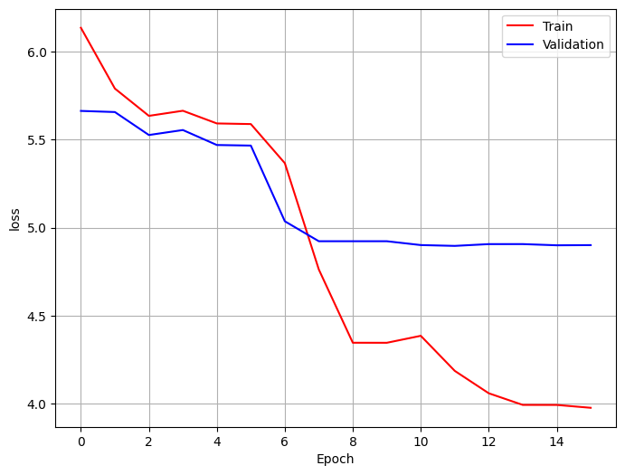

# LSTM Language Model

Word-level next-token prediction and text generation with **PyTorch**, **WikiText-2**, **Word2Vec embeddings**, and a **stacked LSTM**.

This project reorganizes [Arian Abdollahi's Kaggle notebook](https://www.kaggle.com/code/arianabdollahi/language-model-with-lstm) into separate modules for text processing, data loading, embeddings, modeling, training, evaluation, and generation. The original notebook source is preserved in [notebooks/](notebooks/).

## Saved results



Saved learning curve from the original Kaggle notebook. The displayed final validation losses are approximately **4.90**, with reported perplexity around **134**. These are historical outputs; the refactored package has not been trained on the full corpus. See [results and limitations](reports/results.md) and [figure provenance](figures/README.md).

One saved generated-text example:

```text
Prompt:     i want to travel
Generated:  i want to travel to the island .
```

The example is a selected qualitative sample, not a measure of general language quality.

## Model and defaults

| Component | Configuration |
| --- | --- |
| Vocabulary | Built from training tokens only; `<unk>` at index 0 |
| Embeddings | 300 dimensions; Word2Vec initialization; trainable by default |
| Word2Vec | Window 25, minimum count 5, 5 epochs, one worker |
| Recurrent model | 2 unidirectional LSTM layers, hidden size 512 |
| Dropout | 0.25 on embeddings; 0.25 between LSTM layers |
| Output | Linear projection to vocabulary logits at every time step |
| Training | Sequence length 35, batch size 20, AdamW, learning rate 0.00001 |
| Regularization | Weight decay 0.0001; gradient clipping at 0.25 |
| Generation | Temperature sampling with optional top-k filtering and a token limit |

Training resets recurrent state between sequence examples. Generation carries the LSTM state forward after processing the prompt.

## Repository layout

| Path | Purpose |
| --- | --- |
| [src/lstm_language_model/text.py](src/lstm_language_model/text.py) | English-style tokenization and vocabulary |
| [src/lstm_language_model/data.py](src/lstm_language_model/data.py) | Corpus reading, shifted token windows, padded batches |
| [src/lstm_language_model/embeddings.py](src/lstm_language_model/embeddings.py) | Word2Vec training on token lists |
| [src/lstm_language_model/model.py](src/lstm_language_model/model.py) | Embedding, LSTM, and output projection |
| [src/lstm_language_model/engine.py](src/lstm_language_model/engine.py) | Training/evaluation loops and token metrics |
| [src/lstm_language_model/checkpoint.py](src/lstm_language_model/checkpoint.py) | Portable model, vocabulary, config, and corpus metadata |
| [src/lstm_language_model/train.py](src/lstm_language_model/train.py) | Training CLI |
| [src/lstm_language_model/evaluate.py](src/lstm_language_model/evaluate.py) | Held-out loss and perplexity CLI |
| [src/lstm_language_model/generate.py](src/lstm_language_model/generate.py) | Prompt-based text generation CLI |
| [src/lstm_language_model/analyze.py](src/lstm_language_model/analyze.py) | Corpus statistics and common words |
| [configs/default.json](configs/default.json) | Paths and experiment settings |
| [notebooks/01_workflow.ipynb](notebooks/01_workflow.ipynb) | Guided package workflow |
| [notebooks/language_model_original.ipynb](notebooks/language_model_original.ipynb) | Unmodified Kaggle source, version 3 |
| [docs/REFACTOR.md](docs/REFACTOR.md) | Changes from the notebook |

## Installation

Use Python **3.12** and a fresh environment. From the repository root:

```bash
git clone https://github.com/Arian-Abdollahi/lstm-language-model.git
cd lstm-language-model
python -m venv .venv
source .venv/bin/activate
python -m pip install --upgrade pip

# CPU build used for verification:
python -m pip install torch==2.15.0 --index-url https://download.pytorch.org/whl/cpu
python -m pip install -r requirements-tested.txt
```

On Windows, activate with `.venv\Scripts\activate`. For GPU training, install a CUDA-compatible PyTorch build from the [official selector](https://pytorch.org/get-started/locally/), then run `python -m pip install -r requirements.txt`.

The package uses Python tokenization rules directly and does not require torchtext, torchvision, or torchaudio. The original notebook's legacy environment is documented separately in [docs/REFACTOR.md](docs/REFACTOR.md).

## Data setup

Obtain the pretokenized **WikiText-2** training, validation, and test files separately. The defaults expect:

| Split | Default file |
| --- | --- |
| Train | `data/wikitext-2/wiki.train.tokens` |
| Validation | `data/wikitext-2/wiki.valid.tokens` |
| Test | `data/wikitext-2/wiki.test.tokens` |

Set `data_dir` and filenames in `configs/default.json` if your paths differ. On Kaggle, the notebook's location is `/kaggle/input/wikitext2/`. See [data/README.md](data/README.md) for dataset sourcing and format details. Corpus files and trained weights are not included.

## Inspect and train

```bash
python -m lstm_language_model.analyze --config configs/default.json
python -m lstm_language_model.train --config configs/default.json

# Example with the notebook's Kaggle mount:
python -m lstm_language_model.train \
  --data-dir /kaggle/input/wikitext2 \
  --output-dir /kaggle/working/lstm-run
```

The default is 2 epochs per run. Choose a new output directory for each experiment. The run saves `best.pt`, `last.pt`, `history.json`, `vocabulary.json`, `config.json`, `corpus.json`, and `environment.json` under `artifacts/` by default. The best checkpoint is selected by validation loss. Use `--no-word2vec` to initialize trainable embeddings randomly instead.

## Evaluate

```bash
python -m lstm_language_model.evaluate \
  --checkpoint artifacts/best.pt \
  --split test \
  --output artifacts/test_metrics.json
```

Evaluation reports cross-entropy averaged over actual next-token targets and perplexity as its exponential. Partial final windows are retained, batch padding is excluded, and corpus fingerprints prevent accidental evaluation on a changed split. `<unk>` remains a real target token. If the files moved, provide `--data-dir` with their new directory.

## Generate text

```bash
python -m lstm_language_model.generate \
  --checkpoint artifacts/best.pt \
  --prompt "i want to travel" \
  --temperature 0.5 \
  --top-k 20 \
  --max-new-tokens 35 \
  --seed 42
```

Generation samples from the model's probabilities, suppresses `<unk>` by default, and stops after a generated period or the token limit. `--top-k 1` selects the most likely allowed token; `--top-k 0` samples the full allowed vocabulary. Temperature must be positive. Checkpoints trained with this package are required; notebook model pickles are not directly supported.

Installed commands `lm-inspect`, `lm-train`, `lm-evaluate`, and `lm-generate` provide the same entry points.

## Verification and notebooks

```bash
python -m unittest discover -s tests -v
python scripts/smoke_test.py
```

The checks exercise token shifts, masking, recurrent-state reuse, checkpoint reload, sampling, and the CLI workflow on a tiny generated corpus. See [docs/VERIFICATION.md](docs/VERIFICATION.md) for the recorded results and limits. Full WikiText-2 training and GPU execution have not been rerun.

For the guided notebook and optional plotting helpers, install `python -m pip install '.[notebooks]'`, then run `jupyter lab` and open `notebooks/01_workflow.ipynb`.

## License and credits

The source notebook is displayed under Apache License 2.0; this code adaptation retains that license. See [LICENSE](LICENSE), [NOTICE](NOTICE), and [CREDITS.md](CREDITS.md). The saved figure is reproduced from the linked notebook. WikiText content retains its dataset terms and is not relicensed by the code license.
